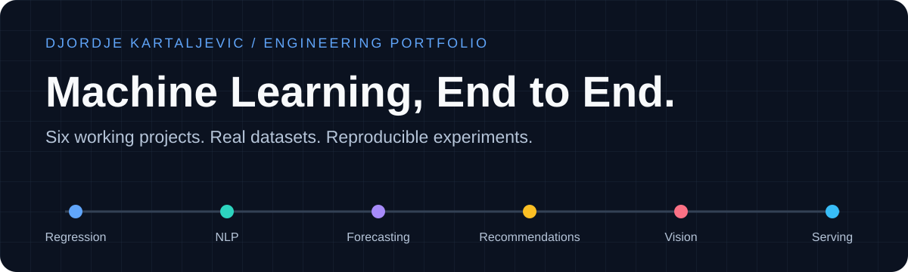

<p align="center"></p>

# Machine Learning Portfolio

**A progression from careful regression to a tested ML prediction service.**

Six independent repositories demonstrate how to turn a machine-learning idea into a runnable experiment: acquire real data, prevent leakage, compare a baseline, select models without touching the test set, inspect failures and expose predictions through clear interfaces.

Every project contains working training and inference code, an executed review notebook, measured metrics and plots, detailed documentation, tests and a GitHub Actions workflow. All run locally on CPU without API keys or paid services.

## Explore from easier to harder

| # | Project | Level | Main engineering lesson |
| ---: | --- | --- | --- |
| 01 | [Wine Quality Lab](https://github.com/Djordje3002/wine-quality-ml) | Beginner | Grouped cross-validation and baseline-first regression |
| 02 | [SMS Spam Detector](https://github.com/Djordje3002/sms-spam-detector) | Intermediate | Sparse NLP, duplicate handling and precision policy |
| 03 | [Bike Demand Forecasting](https://github.com/Djordje3002/bike-demand-forecasting) | Intermediate+ | Future-safe features and rolling evaluation |
| 04 | [MovieLens Recommender](https://github.com/Djordje3002/movielens-recommender) | Advanced | Latent factors, ranking metrics and cold start |
| 05 | [Digits CNN Lab](https://github.com/Djordje3002/digits-cnn-lab) | Advanced | Training loops, checkpoints and visual failures |
| 06 | [Concrete Strength MLOps](https://github.com/Djordje3002/concrete-strength-mlops) | Advanced systems | Uncertainty, validated HTTP serving and monitoring |


The ordering reflects increasing implementation and evaluation complexity. The last project emphasizes system design and serving rather than a more complex statistical model.

## Results with context

| Project | Measured result on its stated test split |
| --- | --- |
| [Wine Quality Lab](https://github.com/Djordje3002/wine-quality-ml) | MAE **0.537** quality points; mean baseline **0.718** |
| [SMS Spam Detector](https://github.com/Djordje3002/sms-spam-detector) | Spam F1 **0.956**; precision **97.56%**, recall **93.75%** |
| [Bike Demand Forecasting](https://github.com/Djordje3002/bike-demand-forecasting) | MAE **932** rentals/day; seasonal baseline **1,342** |
| [MovieLens Recommender](https://github.com/Djordje3002/movielens-recommender) | Warm factorization RMSE **1.000**; mean baseline **1.195** |
| [Digits CNN Lab](https://github.com/Djordje3002/digits-cnn-lab) | CNN accuracy **98.61%**; linear baseline **96.39%** |
| [Concrete Strength MLOps](https://github.com/Djordje3002/concrete-strength-mlops) | MAE **3.379 MPa**; nominal 90% interval covers **91%** |


These are separate experiments with different datasets and protocols; their metrics cannot be compared to each other. Full baseline tables, split sizes, dependency versions, source hashes and limitations are committed in each repository's `reports/metrics.json` and model card.

The portfolio keeps inconvenient findings visible:

- **Forecasting:** ridge regression beats boosted trees under the rolling validation protocol.
- **Spam filtering:** a 98% validation precision target becomes 97.56% precision on the held-out test set.
- **Recommendations:** popularity wins validation NDCG and remains selected, even when factorization performs better on the warm-user test cohort. The global time split produces substantial cold start, reported separately.
- **Vision:** the dataset is a small 8×8 UCI subset, and the split does not establish unseen-writer generalization.
- **Uncertainty:** 91% empirical coverage is accompanied by a 19.203 MPa interval width and explicit exchangeability assumptions.

## Start running a project

```bash
git clone https://github.com/Djordje3002/wine-quality-ml.git
cd wine-quality-ml
python3.11 -m venv .venv
source .venv/bin/activate
python -m pip install -e ".[dev]"
python -m wine_quality train
python -m wine_quality predict --input examples/sample.json
make check test
```

Each repository lists its own module name and complete input example. Use Python 3.11 or 3.12; activate `.venv\Scripts\activate` on Windows. The first training run downloads and verifies its source archive, except digits, whose data ships with scikit-learn. Raw data and model binaries stay local and are not committed.

## What to inspect as a reviewer

| Question | Evidence |
| --- | --- |
| Does the project actually run? | Training/prediction commands, executed notebook and full-training CI job |
| Is the result better than a simple baseline? | Side-by-side held-out metrics, including losing complex models |
| How is leakage addressed? | Grouped duplicates, train-only vectorizers, past-only lags and global temporal splits |
| Can the experiment be reproduced? | Fixed seed, pinned runtime dependencies, source checksums and provenance |
| Are failure modes visible? | Model cards, error gallery, cold-start counts and interval width |
| Are important behaviors tested? | 52 local tests across split, inference, ranking, integrity and HTTP contracts |
| How does a model become a service? | Validated batches, artifact IDs, readiness, monitoring and a non-root Docker definition |

## Repository tour

The standalone project READMEs explain the problem, design choices, data attribution, quick start, measured results and limitations. `docs/DATA_CARD.md` records provenance and licensing; `docs/MODEL_CARD.md` bounds interpretation; `docs/EXPERIMENTS.md` explains reproduction. Notebooks read the package's committed reports so the narrative stays tied to executable training code.

The [Concrete Strength API guide](https://github.com/Djordje3002/concrete-strength-mlops/blob/main/docs/API.md) includes a ready-to-run HTTP request and deployment boundaries. The service was tested locally; Docker was unavailable for container verification. No public production deployment is claimed.

## Data and licensing

Code in these repositories is MIT licensed. UCI datasets have separate CC BY 4.0 attribution requirements. MovieLens has separate research-use and redistribution restrictions, linked in its data card; its raw data and user factors are excluded from Git.

This index contains [machine-readable project metadata](portfolio.json). Each repository is independently installable and does not depend on a shared private package.

Created by [Djordje Kartaljevic](https://github.com/Djordje3002) · [GitHub profile](https://github.com/Djordje3002) · [LinkedIn](https://www.linkedin.com/in/djordje-kartaljevic-50b333298/)
